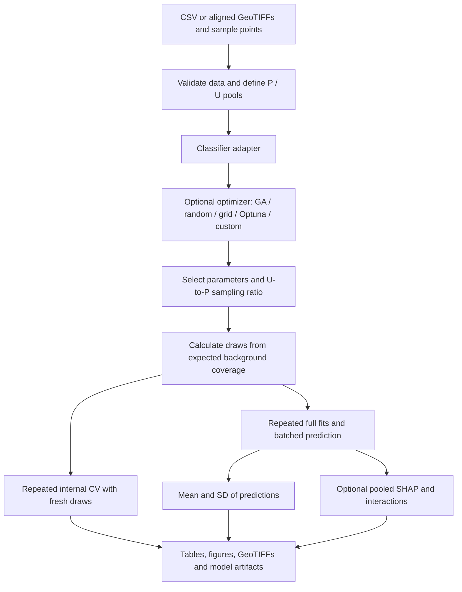

# PU Bagging Framework

A configurable positive–unlabeled (PU) bagging workflow for spatial prospectivity studies and other tabular classification problems. Choose your dataset, classifier, optimizer, explanations, figures, and export formats in YAML.

[中文使用说明](README_zh.md) · [Configuration and extensions](docs/configuration.md) · [Migration from the RF script](docs/migration.md)

The workflow holds known positives fixed, repeatedly draws from an unlabeled pool, temporarily labels those draws as negative, and aggregates the fitted classifiers. It retains the original research workflow while separating data-specific settings from reusable algorithms. It **does not introduce a new PU-learning algorithm** or reproduce published numerical results automatically.



## Quick start

Python 3.10 or newer. Run from this project folder:

```bash
python -m venv .venv
# Windows PowerShell: .\.venv\Scripts\Activate.ps1
# Linux/macOS: source .venv/bin/activate
python -m pip install -e ".[plots]"
python examples/make_demo_data.py
python -m pu_bagging validate examples/demo.yaml
python -m pu_bagging run examples/demo.yaml
```

The example is synthetic. It contains no unpublished study data. `validate` checks inputs and a preliminary split without training; when the ratio is optimized, the final number of draws is determined later.

For the complete plotting and export workflow:

```bash
python -m pip install -e ".[all]"
python -m pu_bagging run examples/full_outputs.yaml
```

Separate examples demonstrate [XGBoost + Optuna](examples/xgboost_optuna.yaml), [logistic regression + grid search](examples/logistic_grid.yaml), and [raster data + GA](examples/raster_template.yaml). Use a fresh `output_dir` for every run; nonempty directories are never overwritten.

[The original-study template](examples/original_study_template.yaml) retains the 20 predictor names and research-scale search ranges with portable placeholder paths. [Local validation results](docs/validation.md) record the tested combinations.

## What can be replaced?

| Component | Built-in choices | Extension |
|---|---|---|
| Data | Labeled CSV; aligned predictor rasters + P/U point files | Prepare a CSV or add a data adapter |
| Classifier | Random Forest, Extra Trees, logistic regression, XGBoost | `module:Classifier`, sklearn-compatible `fit` and `predict_proba` |
| Search | None, genetic algorithm, random search, grid search, Optuna TPE | `module:optimizer`, same maximization objective |
| Evaluation | Stratified CV, predefined groups, projected spatial blocks | Group IDs can be supplied in CSV |
| Explanation | Tree SHAP, model-agnostic permutation SHAP | Optional, independently enabled |
| Output | CSV, Excel, GeoTIFF, per-fit SHAP arrays, saved pipelines | Tables and export functions are independent of model choice |
| Figures | AUC, ROC, search history, mean/SD maps, correlation, capture, SHAP | Select figure families, DPI and PNG/PDF/SVG/TIFF formats |

CSV labels must be `1 = known positive`, `0 = unlabeled`. They are not ground-truth negative labels. Feature names are arbitrary and configurable. Raster inputs must have identical grid geometry and CRS; vector samples are reprojected to that CRS. Exclusion buffers and the eligible background pool are prepared by the researcher, not inferred by the framework.

## Outputs

Every successful run writes `config_resolved.json`, `data_summary.json`, `selected_parameters.json`, `metrics.json`, `run_metadata.json` and `run.log`. Optional exports include:

- `tables/`: every-draw and every-fold AUC, ROC, optimizer history, sampled-pool counts, prediction mean/SD, correlation, and SHAP statistics.
- `results.xlsx`: the same tables in indexed worksheets; oversized row tables are split rather than truncated.
- `probability_mean.tif`, `probability_std.tif`: georeferenced output for raster input, preserving nodata masks.
- `figures/`: independent figure families. Default export resolution is 600 ppi.
- `explanations/draw_*.npz`: raw input values, IDs and SHAP values per fitted ensemble member, with optional interaction arrays.
- `models/`, `ensemble.json`: optional saved preprocessing + classifier pipelines.

Reuse trusted saved models on a feature CSV:

```bash
python -m pu_bagging predict outputs/demo_rf data/demo/prediction.csv outputs/new_predictions.csv
```

`predict_saved()` also provides a Python API. Output `probability_std` is the population SD among ensemble members, not a confidence interval. Tree SHAP uses the estimator's native output (e.g. RF probabilities, XGBoost raw margins), so absolute SHAP magnitudes should not be directly compared between algorithms. Permutation SHAP explains positive-class probability for either model.

Regenerate figures without retraining or reading the original dataset:

```bash
python -m pu_bagging plot outputs/full_outputs outputs/replot --dpi 600 --formats png pdf
python -m pu_bagging plot outputs/full_outputs outputs/replot_shap --only shap_importance shap_dependence --formats svg
```

This reads exported CSV tables (or the indexed Excel workbook if CSV is disabled) and `plot_context.json`. Choose a new output directory for the regenerated figures.

SHAP distribution figures follow the manuscript's statistical definitions: boxes show the interquartile range, markers show the mean, and whiskers show mean +/- population SD across fits. Dependence figures show the pooled bin mean with minimum–maximum, interquartile, and mean +/- SD shading. The default 20 quantile bins use 1% tail clipping, as in the original script, and bin-boundary midpoints on the x-axis.

The [method consistency review](docs/method_consistency.md) checks the reusable single-model workflow against the manuscript. Cross-model consensus zoning is outside the requested framework scope. Historical hyperparameters, draw counts and AUCs are not hard-coded.

## Sampling and evaluation definitions

For `P` positives, `N` eligible unlabeled rows and ratio `r`, each draw takes `k = min(ceil(P*r), N)` distinct unlabeled rows. Rows can reappear in later draws. The smallest budget satisfying target expected coverage `C` is:

```text
M = ceil(log(1-C) / log(1-k/N))
expected_coverage = 1 - (1-k/N)^M
```

If `k=N`, one draw suffices. Expected coverage is not a guarantee about observed coverage; both values are exported. `sampling.rounds` can explicitly override the computed budget. Search uses `optimizer.screening_rounds`; only the selected ratio determines the final budget.

All candidates use common sampling seeds. Search, repeated evaluation, and final fits use separate sampling streams. By default the estimator seed is fixed across draws (`model.seed_mode: fixed`) to focus on background selection; `per_draw` also includes model randomness. Fold preprocessing is fitted on training rows only. Spatial groups never cross a train/validation boundary within a split. With `GroupKFold`, assignments are recomputed for each sampled dataset, as in the source script. Single-class folds fail explicitly.

The reported CV is **internal evaluation after parameter selection**, not nested CV or independent external validation. AUC compares positives with the sampled unlabeled background. The average positive-class score is not calibrated to geothermal prevalence. The capture curve uses known training positives and is a descriptive ranking diagnostic, not additional validation. SHAP values are pooled from fitted training sets; repeated occurrences remain repeated in that pool.

## Tests and repository layout

```bash
python -m pip install -e ".[dev,all]"
python -m pytest -q
```

```text
src/pu_bagging/
  data.py          # CSV, rasters, point sampling and spatial groups
  sampling.py      # expected coverage and deterministic draws
  models.py        # preprocessing, classifier adapters and weighting
  optimizers.py    # shared search interface and selectable optimizers
  evaluation.py    # repeated CV
  ensemble.py      # streaming prediction moments and inference
  explain.py       # SHAP, quantile bins and interactions
  outputs.py       # tables, Excel and GeoTIFF
  plots.py         # table-driven figure generation
  replot.py        # regenerate figures from saved tables without refitting
  pipeline.py      # orchestrates these components
  cli.py           # validate / run / predict / plot
examples/          # synthetic generator, configurations and custom optimizer
tests/             # core and optional integration tests
docs/              # configuration and migration notes
```

## Uploading to GitHub

Upload this project folder's contents, including `src`, `examples`, `tests`, `docs`, `.github`, `pyproject.toml` and the README files. Data, fitted models, outputs, and virtual environments are excluded by `.gitignore`. Runtime output files can contain sample coordinates and local paths; they are not included in the prepared source archive.

No distribution license has been selected on the author's behalf. Add your chosen license before describing the repository as open source. The manuscript citation can be added when its final bibliographic details are available.
